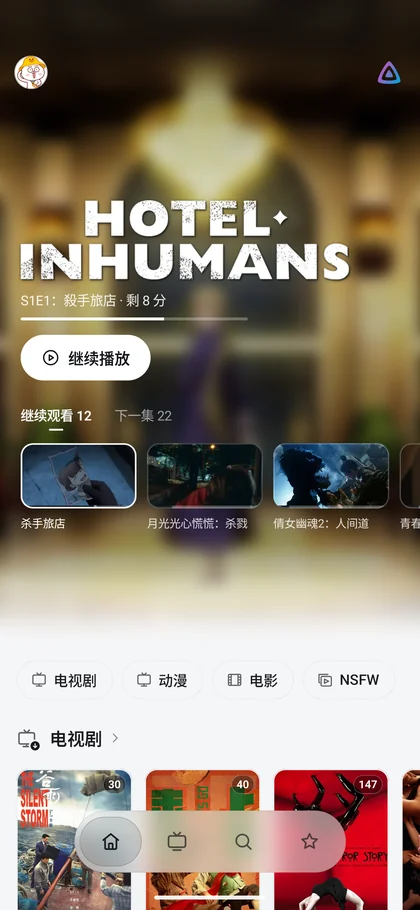
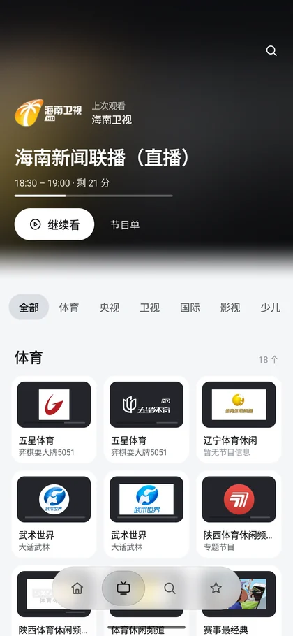
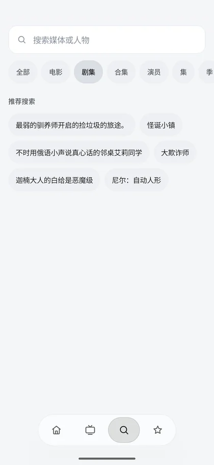
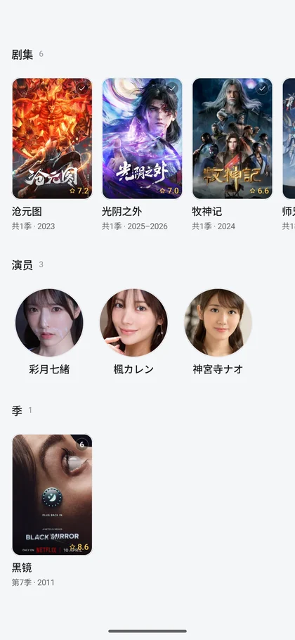
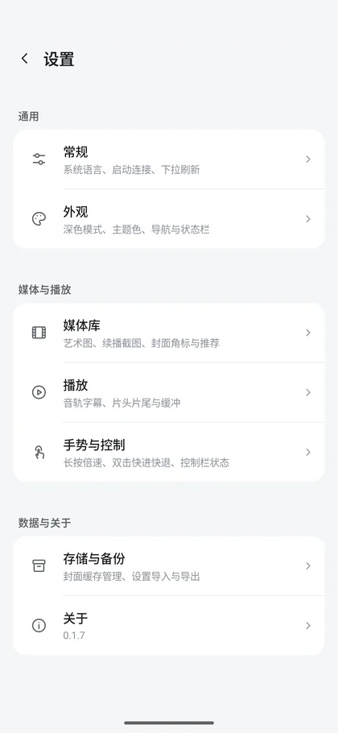
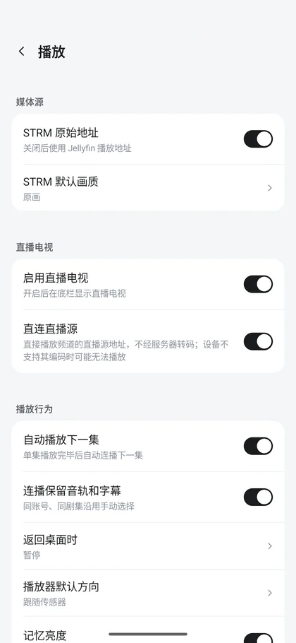

<p align="center"></p>

# Pathfin

English | [简体中文](README.zh-CN.md)

[](https://github.com/li88iioo/Pathfin/releases/latest/download/Pathfin-arm64-v8a.apk)

A native Jellyfin client for Android phones and tablets, built with Kotlin and Jetpack Compose. It can play the original HTTP(S) STRM addresses provided by server media sources.

## Screenshots

<p align="center">
  <a href="assets/screenshots/home.webp"></a>
  <a href="assets/screenshots/series-details.webp"></a>
  <a href="assets/screenshots/live-tv.webp"></a>
</p>

<p align="center">
  <a href="assets/screenshots/episode-picker-landscape.webp"></a>
</p>

<details>
<summary>Search, favorites and settings (4 screenshots)</summary>

<p align="center">
  <a href="assets/screenshots/search.webp"></a>
  <a href="assets/screenshots/favorites.webp"></a>
  <a href="assets/screenshots/settings.webp"></a>
  <a href="assets/screenshots/playback-settings.webp"></a>
</p>

</details>

## Features

- Multiple servers, multiple accounts and fallback addresses.
- Home, libraries, search, favorites, filters and sorting, alphabet navigation and automatic paging. Long-press covers in a library to select several items and mark them played or unplayed, refresh their metadata or delete them.
- Media details, resume, episode picker, subtitles, audio tracks, chapters and picture-in-picture.
- ExoPlayer-based player with ARM64 FFmpeg audio and video fallback decoding, GPU color processing, optional ASS rendering and four playback quality levels. Supports direct cloud-quality playback for [MediaFlux](https://github.com/li88iioo/MediaFlux) STRM.
- Subtitle import from the device, upload to the server and online search. Download network rules and a default save folder.
- Media downloads, metadata and image management, Live TV and DLNA.
- Light and dark themes, cover cache, hidden system status bar, and settings import and export.
- English and Simplified Chinese interface, following the system or per-app language setting.

Requires Android 8.0 (API 26) or later. The libass and FFmpeg native extensions currently support ARM64 only. Online subtitles need a subtitle provider and the matching permissions on the server. MediaFlux STRM qualities come from resources that already exist on the cloud drive; media data goes straight to the phone and never silently switches to Jellyfin transcoding. Regular server media still negotiates playback according to the server's capabilities. A local path on the server's disk can't be used as a playback address the phone can reach.

> **Note:** STRM direct playback and STRM quality switching have only been tested with STRM files generated by [MediaFlux](https://github.com/li88iioo/MediaFlux) and with Guangya Cloud Drive (光鸭云盘). STRM from other sources is unverified.

If you run into a problem, check [Help & FAQ](docs/help-faq.md) first.

See the [changelog](CHANGELOG.md) for version history and [GitHub Releases](https://github.com/li88iioo/Pathfin/releases) for official packages.

## STRM cloud quality

With **STRM original address** turned on, MediaFlux STRM that supports the quality protocol reuses the player's **Original / High quality / Standard / Smooth** menu and shows the real resolution and codec of each cloud quality. Unavailable levels can't be selected. Switching keeps the playback position, pause state and speed. If fetching a quality fails, the current playback continues, and an expired direct link can be resolved again.

Original-quality capability checks keep Jellyfin's full video track information, including Dolby Vision profile, bit depth and dynamic range; compressed cloud levels are checked against their own formats. When the default Original quality is known to be undecodable, the highest compatible cloud level is chosen without changing the default quality preference. If no compatible cloud level exists, the app says the device can't play it and does not start Jellyfin transcoding. When a manual quality switch fails, the app first restores the resource that was playing; a network error renews the original STRM address only once.

Video prefers the system MediaCodec. On ARM64, FFmpeg can also decode H.264 (including Hi10P), HEVC, MPEG-2, MPEG-4 Part 2 (including Xvid/DivX), Microsoft MPEG-4 v2/v3, H.263 and VC-1 Advanced Profile in WVC1 Matroska. VVC (H.266) software decoding supports MP4, M4V and MOV. For VVC in Matroska or MPEG-TS, use Jellyfin transcoding. For Blu-ray M2TS and ASF/WMV, server playback asks Jellyfin for a compatible stream. A local audio or video decoder can take over once on the same source while keeping position, speed, pause state and track selection.

Progressive Dolby Vision P7 can use its HDR10 HEVC base layer when the device cannot handle the Dolby track. The software decoder displays the HDR10 base-layer picture for compatible P7 FEL files. P4 and P8 can fall back to HEVC, P9 to H.264, and compatible P10 to AV1. P5 uses Dolby metadata for software color mapping. The software path maps video to SDR on the GPU and accepts up to 4096 pixels per side and 4096×2304 pixels in total. Real-time playback depends on the device, encoding complexity and frame rate.

Pathfin supports PGS and VobSub tracks embedded in Matroska. When Jellyfin provides a standalone PGS/SUP delivery URL, the player loads bitmap subtitles on selection and follows the video clock when seeking. For DVD subtitles stored as an external IDX/SUB pair, mux the track into MKV for client-side playback.

**STRM default quality** replaces the old hand-typed "preferred version". It defaults to Original and only affects the next start of STRM that supports the protocol. Local files and Live TV don't use cloud qualities. Multiple file versions can still be picked by hand, and old version-name preferences are never guessed into a quality.

When a movie, series or video explicitly uses the original path with Original selected, plain HTTP STRM also stays direct, without requiring the server to implement the cloud quality protocol. If the device is known to be unable to handle it, or decoding actually fails, the app does not substitute Jellyfin transcoding. After turning off the original path or choosing a server quality, playback negotiates with the server's capabilities again. Network retries on the original address keep the direct choice.

The server must provide the `variants` / `resolve` endpoints of `mediaflux.playback.v1`. When connecting through the MediaFlux media proxy, Pathfin uses the signed path and query from `MediaSource.MediaFluxPlayback` with the connected server's scheme, host and port. This preserves the public entry even if a front proxy rewrites its Host header. MediaFlux must support quality queries on the media proxy; the phone does not need access to the internal panel address. When connecting to Jellyfin directly, the original STRM URL must still be reachable. Only the signed entry is stored for queries and renewal. Temporary CDN URLs are never treated as new media versions, and Jellyfin account credentials are never sent to the cloud drive.

## Building

Requires JDK 17, Android SDK Platform 37.2, and the project-locked NDK 30.0.16248370 and CMake 3.22.1. Point to the SDK with `ANDROID_HOME` or a local `android/local.properties`.

Native libraries are not committed. Before the first build, generate the ASS and FFmpeg audio/video modules with their license assets and corresponding source archives:

```bash
python3 android/ffmpeg/build_native.py --jobs 2
python3 android/ass/build_native.py --jobs 2
python3 android/tools/package_source.py --native ffmpeg --output .superpowers/tmp/ffmpeg-native/release/pathfin-ffmpeg-corresponding-source.tar
python3 android/tools/package_source.py --native ass --output .superpowers/tmp/ass-native/release/pathfin-ass-corresponding-source.tar
```

Native build prerequisites, locked inputs and corresponding-source notes are in the [ASS module](android/ass/README.md) and [FFmpeg audio/video module](android/ffmpeg/README.md) READMEs. FFmpeg decodes audio and video and handles resampling. libplacebo handles video color mapping with GLES, and Media3 manages the network, container and playback clock. libass and its font parsing and shaping dependencies are statically linked into the ASS JNI library. The two modules have no runtime dependency on each other, and only the ASS module packages the NDK shared C++ runtime.

```bash
cd android
./gradlew :app:assembleDebug :app:testDebugUnitTest
```

Release builds use `:app:assembleRelease` with R8 and resource shrinking. Signing reads `~/.local/share/pathfin/signing/release.properties` outside the repository by default, or a file given with `-Ppathfin.signingFile=/absolute/path/release.properties`; the file provides `storeFile`, `storePassword`, `keyAlias` and `keyPassword`.

The debug package is `dev.pathfin.android.debug` and the release package is `dev.pathfin.android`; their data is separate.

Before publishing, run `android/tools/verify_release.py` on the final APK, with `--build-tools` for the build-tools directory, `--expected-certificate-sha256` for the confirmed production signing certificate digest and `--output` for the report. It checks the release package identity, expected signature, 16 KiB alignment, native dependencies, offline licenses and test-resource isolation. Never derive the "expected certificate" from the APK under test. For a full install and playback regression, use the [standalone release smoke tool](android/tools/production_smoke/README.md), only in a freshly installed test environment without personal accounts.

## Changelog and releases

Pushing `main` or manually running **Build and release** in GitHub Actions runs tests, release lint, a signed APK build and native-source verification. Verified APK/source artifacts and reports are retained for 7 days. These runs do not publish a Release; publication only happens on a matching `vX.Y.Z` tag push.

`CHANGELOG.md` is the single source for version changes. GitHub Release uses the matching version's body, which the in-app update dialog also displays. Use short lists and absolute links; avoid tables, images and complex Markdown.

When preparing a release, check `versionName` and the increasing `versionCode` in `android/app/build.gradle.kts`. Review `git log --reverse --no-merges <previous-release-tag>..<target-commit>` for additions, improvements, fixes and necessary upgrade instructions; for the first release, review all history through the target commit. Do not update the changelog for every development commit or treat local builds as formal releases.

Use `## [X.Y.Z] - YYYY-MM-DD` for each version heading and at least one `- Description` list item. Set the actual release date when preparing the tag. Add real commit links where traceability is useful and a comparison link when a previous release tag exists. If an `[Unreleased]` comparison link is retained, update it to compare the new tag with `HEAD`.

Before committing release changes, validate and preview the notes from the repository root:

```bash
python3 -m unittest discover -s android/tools -p 'test_extract_release_notes.py'
mkdir -p .superpowers/tmp
python3 android/tools/extract_release_notes.py CHANGELOG.md 0.1.0 --output .superpowers/tmp/release-notes.md
```

Replace the version in the command with the release version. Pending or invalid dates, missing or duplicate version sections, and empty change lists fail validation. After release verification and committing the changes, create and push the matching `vX.Y.Z` tag on the final commit. The workflow extracts the notes before building and publishing the APK; tag annotations and generated commit summaries are no longer separate sources for the release body.

## Third-party components

The app keeps offline open-source licenses and upstream evidence. When distributing an APK with the FFmpeg audio/video and libass extensions, also provide the two corresponding source archives that match the binaries. `android/tools/verify_native_pairing.py` checks the final APK, native libraries and archives with `--ffmpeg-source` and `--ass-source`; see the native module READMEs for details.

## Acknowledgments

- [LINUX.DO](https://linux.do): A friendly tech community.